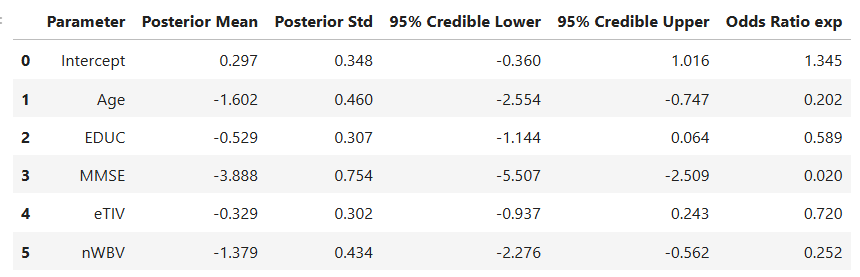
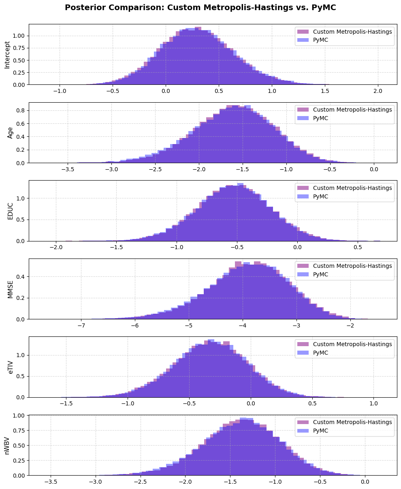
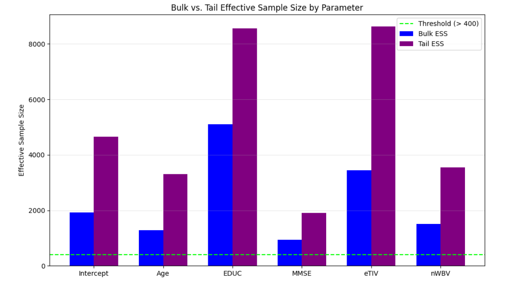
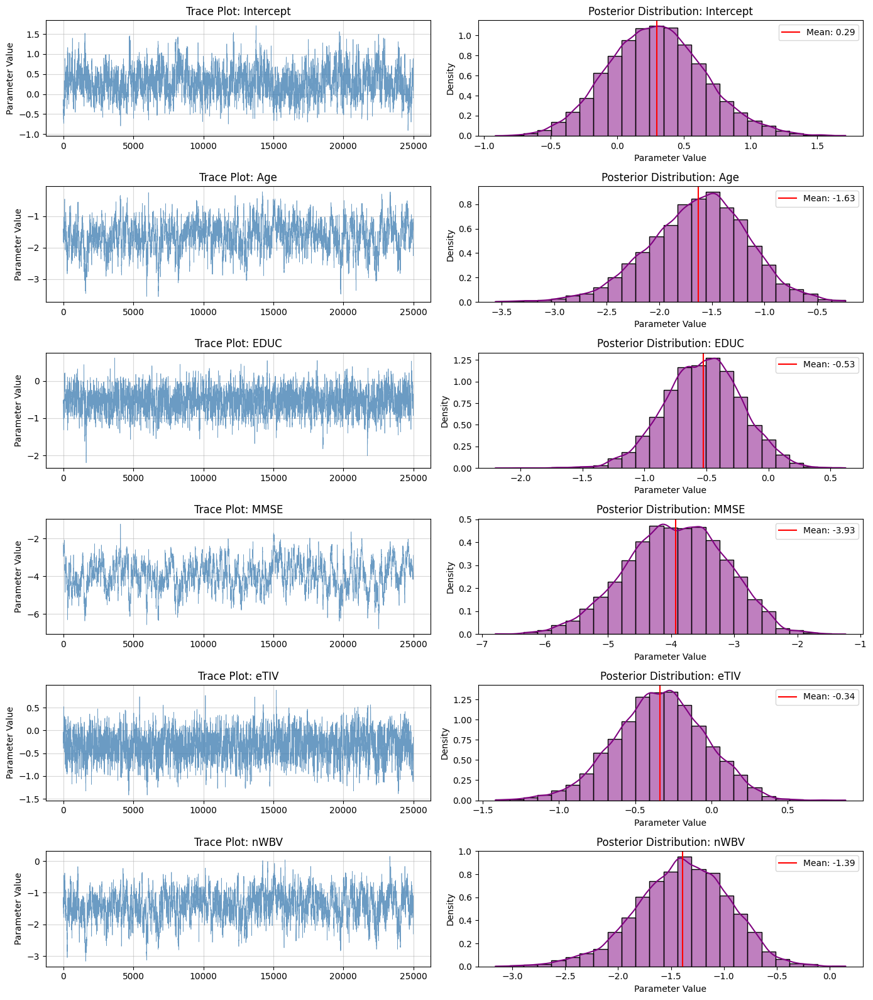
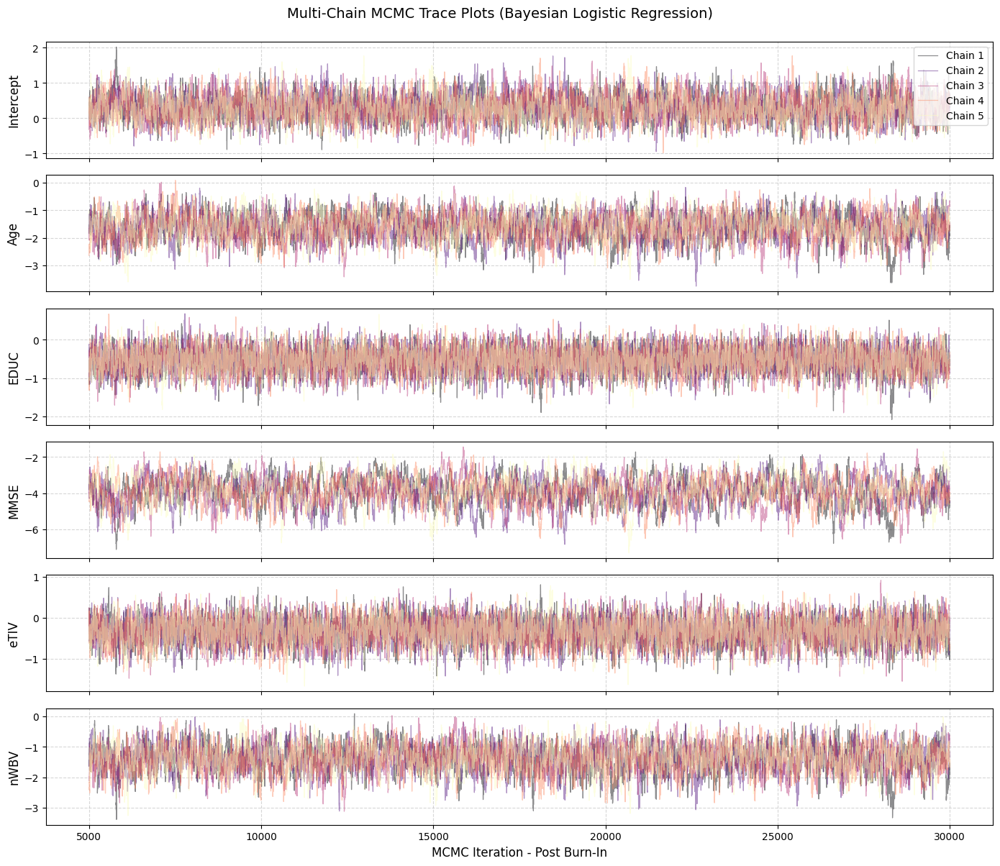

# Custom Parallel Multi-Chain MCMC Sampler for Bayesian Logistic Regression on Cross-Sectional Alzheimer's Progression

---

**Author:** Daniel Therattil

**Methodology:** Custom Metropolis-Hastings MCMC(Markov Chain Monte Carlo) Sampler | Gaussian Priors & Log-Posterior Derivations | Multi-Chain Initialization | Bayesian Logistic Regression 

**Key Validation Metrics:** Gelman-Rubin: $\hat{R} \lt 1.01$ | Rank-Normalized Multi-Chain Split: $\hat{R} \lt 1.01$ | Bulk ESS: $\gt 400$ | Tail ESS: $\gt 400$

---

### Abstract & Methodological Overview
This project is an implementation of a Bayesian Logistic Regression framework built from scratch to evaluate clinical dementia risk using the OASIS Longitudinal cohort. I built it without statistical high-level wrappers (PyMC, Stan, or scikit-learn), the inference engine relies on a custom Metropolis-Hastings Markov Chain Monte Carlo (MCMC) sampler written in NumPy matrix algebra. Metropolis Hastings was chosen because it requires only log-posterior evaluations and is faster to implement and tune for a low-dimensional model compared to more resource-heavy alternatives like Hamiltonian Monte Carlo. However, there is still a comparison later on to a Hamiltonian Monte Carlo implementation for accuracy.

###  Key Statistical Methods and Results:
**Prior Specification & Joint Log-Posterior Formulation:** Evaluated uninformative Gaussian priors across standardized biomarkers and derived the unnormalized log-posterior distribution via matrix vectorization. Handled floating-point numerical stability using log-sum-exp transformations to prevent burgeoning or computational overflow during likelihood calculations.\
\
**Multi-Chain Parallel Sampling Engine:** Deployed parallel Markov chains initialized from dispersed random starting points to thoroughly explore the parameter space over 125,000 post-burn-in Monte Carlo draws.\
\
**Single/Multi-Chain MCMC Convergence Diagnostics:** Evaluated stationarity and mixing efficiency via Gelman-Rubin, Blom's quantile-transformed Rank-Normalized Split, and Charles Geyer's Integrated Autocorrelation Time (IAT) method for Bulk and Tail Effective Sample Sizes.\
\
**Clinical Parameter Results:** Quantified epistemic uncertainty through 95% Credible Intervals and Posterior Odds Ratios, identifying Mini-Mental State Examination (MMSE) and Normalized Whole Brain Volume (nWBV) as the primary inverse risk factors against dementia progression.

### Convergence Diagnostic Summary Table

### Sampler Validation
While convergence diagnostics like before with Gelman Rubin and high Bulk/Tail Effective Sample Size, along with the multi-chain trace plots confirm that my custom Metropolis-Hastings  are mixed well and stabilized, said convergence does not necessarily guarantee that everything is correct. This is especially evident since I'm doing it from scratch. For example, a flawed log-posterior implementation or subtle scaling bugs can lead to a sampler converging to the a false mathematical target distribution. Thus, to verify whether it's correct or not, I need to see how it fairs in comparison with its draws against PyMC's No-U-Turn Sampler (NUTS), which is just an automated Hamiltonian Monte Carlo algorithm. I know Stan is also a fair option for comparison but I'm choosing PyMC due to it not requiring any C++ compilers etc.

### Diagnostic Visualizations

Below are the single/multi-chain trace plots, posterior distributions, and ESS validations:

